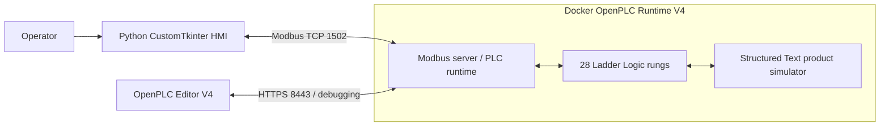

# Autonomous PLC Manufacturing and Customer Order Fulfillment System

An integrated virtual manufacturing and order fulfillment system built with OpenPLC, IEC 61131-3 Ladder Logic and Structured Text, Docker and a custom Python HMI. The PLC independently controls product feeding, processing, inspection, rejection, packaging and automatic order completion; the HMI provides operator commands and live process visualization over Modbus TCP.


## System architecture



The PLC executes a cyclic 20 ms task. The HMI uses a background networking worker and queues to separate communication from GUI updates. Both published ports bind to localhost; the runtime has a persistent Docker volume.

## Manufacturing sequence

1. Operator enters order quantity, batch capacity and defect probability.
2. Start command latches SYSTEM_RUN; a six second startup timer precedes line readiness and conveyor operation.
3. The simulator generates a virtual product and a pseudorandom quality outcome.
4. Ladder Logic controls processing, inspection, acceptance or rejection.
5. Accepted units accumulate in the batch counter. A full batch or the final partial batch triggers packaging.
6. When the accepted quantity is reached and packaging is completed, the order completion state stops production.

## PLC implementation

The 28 rungs use contacts, coils, latching logic, TON and TP timers, CTU counters, ADD, SUB, GE and GT comparisons, and set/reset operations. PRODUCT_SIMULATOR is a Structured Text function block using states 0, 10, 20 and 30 for arrival, quality generation, completion waiting and clearance. It uses a deterministic pseudorandom sequence with configurable defect probability.


## Modbus and HMI

The server allocates 24 coil bits and 16 holding registers. The HMI reads 18 coil positions and nine holding registers using device ID 1. Start, stop and reset are 250 ms pulses. Input validation, settings readback, state-based command restrictions and connection recovery are implemented. The GUI reports accepted/rejected counts, total processed, remaining units, packages, yield and progress.

See [Modbus address map](Documentation/Modbus_Address_Map.md) and [HMI implementation](HMI/README.md).

## Reproduction

1. Install OpenPLC Editor V4, Docker Desktop with Linux containers and Python 3.12 with Tk support.
2. Clone this repository. Follow the [runtime setup](Runtime/README.md) to start or create the container.
3. Open the [native PLC project](PLC/OpenPLCProjects/project.json) in OpenPLC Editor; build, deploy and start it on the configured runtime.
4. From the HMI directory, run:

```powershell
python -m pip install -r requirements.txt
python manufacturing_hmi.py
```

5. Confirm PLC CONNECTED. Reset counters when idle, apply order settings and start production.

A [PLCopen XML export](PLC/PLCopen_Export/plc.xml) is provided for interchange; it is not a substitute for the native project or runtime configuration.

## Demonstrated results

A captured test used order quantity 15, batch capacity 5 and configured defect probability 25%. The system completed the order with:

| Metric | Observed result |
| --- | ---: |
| Accepted | 15 |
| Rejected | 3 |
| Total processed | 18 |
| Remaining | 0 |
| Completed packages | 3 |
| Quality yield | 83.3% |

The configured defect probability is not an exact per-order rejection quota. The completed run verifies order fulfillment, defect rejection and full-batch packaging. A separate screenshot captures active packaging while online Ladder Logic paths are energized.


See the [full screenshot gallery](Media/README.md).

## Scope and limitations

This is a virtual industrial automation portfolio project, not physical machinery or a safety-rated control system. The fresh Docker Compose deployment has not been independently validated. The captured run demonstrates full batches; partial-batch handling exists in the logic but is not separately evidenced by these screenshots.

## Demonstration video

Pending recording and publication.
